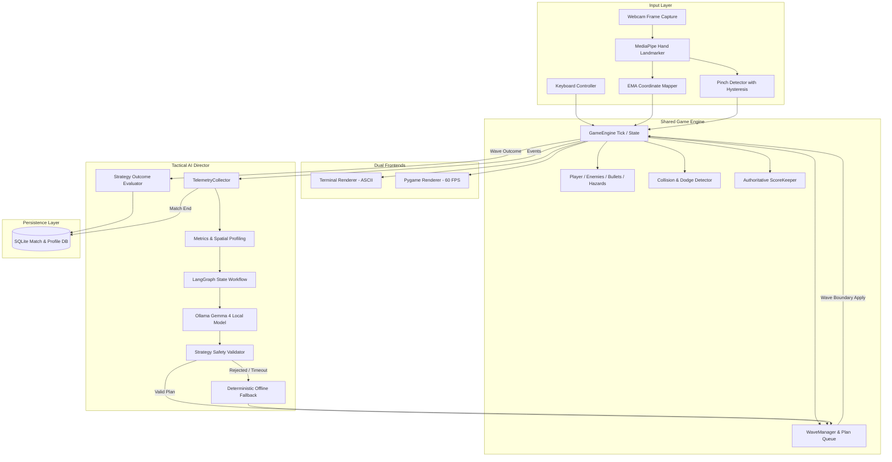
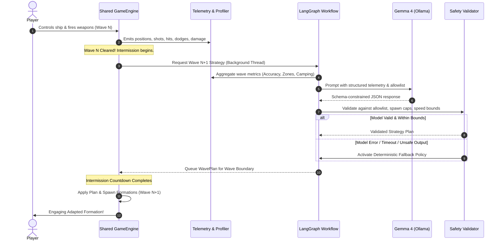

# STARFALL: Adaptive AI Arcade Shooter

> **A real-time Galaga-inspired space shooter powered by local Gemma 4 reasoning, LangGraph tactical orchestration, and computer vision hand tracking.**

---

## 1. Project Overview

**STARFALL** is an adaptive arcade space shooter built from the ground up around a core design principle: **the enemy fleet does not simply follow fixed difficulty curves — it observes player telemetry, identifies weaknesses, and counter-attacks with strategic intent.**

### Three Ways to Play

1. **Terminal Mode (ASCII Arcade)**: A real-time, non-blocking ASCII game loop rendered in your terminal with zero flicker, complete with HUD, particle stars, and live AI Commander briefing.
2. **Pygame Mode (Graphical Arcade)**: A vertical-scrolling space shooter running at 60 FPS featuring glowing laser fire, particle explosions, animated formation sweeps, telegraphed laser lanes, and an AI Commander dashboard.
3. **Computer Vision Gesture Mode**: Control spaceship positioning with your **right hand** and trigger firing by **pinching your left thumb and index finger** together, with an in-game picture-in-picture webcam feed and hand landmark telemetry.

### Core Philosophy

- **Unified Simulation Engine**: Both Pygame and Terminal renderers share the exact same deterministic simulation, collision detection, enemy archetypes, and authoritative scoring rules.
- **Local-First Privacy**: Gameplay reasoning runs locally on your machine via **Ollama + Gemma 4**. No telemetry or webcam frames are ever transmitted to cloud servers.
- **Asynchronous AI Reasoning**: Gemma 4 and LangGraph analyze gameplay between waves in a background worker thread. Heavy model reasoning never blocks or drops frames in the 60 FPS game loop.
- **Robust Deterministic Fallbacks**: If Ollama or the camera is unavailable, the game automatically switches to proven fallback policies and continues uninterrupted.

---

## 2. System Architecture



---

## 3. Adaptive Enemy Director Workflow



---

## 4. Hardware and Model Configuration

### Model Options

| Model Tag | Role | Download-size guide | Notes |
| :--- | :--- | :--- | :--- |
| **`gemma4:e4b`** *(configured primary)* | Local tactical reasoning | Ollama currently lists approximately 6.6–9.5 GB across package variants | Verify with `ollama list`; actual RAM and latency depend on quantization and hardware. |
| **`gemma4:e2b`** *(alternative)* | Smaller local model | Ollama currently lists approximately 4.6–7.5 GB across package variants | Switch to this if E4B is too slow or memory-intensive. |
| Other compatible local models | Optional alternative adapter | Model-dependent | Verify schema-output compatibility and licensing before use. |

> [!NOTE]
> **Open-Weight Licensing Notice**: Gemma 4 is an open-weight model governed by Google's applicable Gemma Terms of Use. It is permitted for local development, research, and non-commercial/commercial applications under its terms. For environments requiring strictly OSI-approved licenses, STARFALL provides a configurable model adapter and deterministic offline mode.

---

## 5. Quickstart & Installation

### Step 1: Clone and Set Up Python Environment

```bash
git clone https://github.com/sukrut07/starfall.git
cd starfall

python3.11 -m venv .venv
source .venv/bin/activate  # On Windows: .venv\Scripts\activate
pip install -r requirements.txt
```

### Step 2: Set Up Ollama and Gemma 4

Copy `.env.example` to `.env` and keep `.env` untracked. The example configures `OLLAMA_MODEL=gemma4:e4b`; you can change it to `gemma4:e2b` if the larger model is not suitable for your machine. Local Ollama inference does not require a cloud API key by default. See [Local Model Setup](docs/LOCAL_MODEL_SETUP.md).

1. Install Ollama from [ollama.com](https://ollama.com).
2. Pull the default Gemma 4 lightweight model:
   ```bash
   ollama pull gemma4:e4b
   ```
3. Verify local model availability:
   ```bash
   python main.py model-check
   ```

---

## 6. How to Play & CLI Reference

### Interactive Menu
Launch the terminal dispatcher menu:
```bash
python main.py
```

### CLI Command Options

| Command | Action |
| :--- | :--- |
| `python main.py play --renderer terminal --control keyboard` | Play the real-time ASCII game with keyboard controls |
| `python main.py play --renderer pygame --control keyboard` | Play 60 FPS graphical arcade shooter with keyboard |
| `python main.py play --renderer pygame --control gesture` | Play graphical arcade shooter with webcam hand gestures |
| `python main.py play --renderer terminal --control gesture` | Play ASCII game with webcam hand gestures |
| `python main.py vision-test` | Test webcam, hand landmark tracking, and pinch detection |
| `python main.py model-check` | Run Ollama service & Gemma 4 inference benchmark |
| `python main.py history` | View past match logs and scores from SQLite |
| `python main.py analyze-last` | Re-open the detailed flight debrief from your last match |
| `python main.py settings` | Inspect active settings and thresholds |
| `python main.py env-check` | Run full hardware, library, and system diagnostic |

---

## 7. Controls Guide

### Keyboard Controls
- **Move**: `W / A / S / D` or Arrow Keys (`↑`, `←`, `↓`, `→`)
- **Fire**: `Spacebar`, `J`, or `Z` (hold for continuous fire)
- **Pause**: `P`
- **Restart (after game over)**: `R`
- **Quit**: `Q` or `ESC`

### Gesture Controls (Webcam Vision)
- **Right Hand**: Controls spaceship positioning on screen. Move your right hand across your field of view to smoothly steer the fighter.
- **Left Hand**: Controls laser weapons. **Pinch your left thumb and index fingertip together** to fire. Release fingers to stop firing.
- *Hysteresis and Debounce*: Separate engage (`0.055`) and release (`0.085`) thresholds prevent finger jitter from triggering false shots.

---

## 8. Adaptive Tactics & Allowlist Rules

To prevent unsafe or impossible commands from disrupting gameplay, Gemma 4 is restricted to a strict allowlist of supported formations and hazards:

### Allowed Formations
- `v_formation`: Classic formation apex with tough Dreadnought leader.
- `center_sweep`: Horizontal sweeping rows testing player cross-lane accuracy.
- `left_flank`: Heavy concentrated attack on the left corridor (counters right campers).
- `right_flank`: Heavy concentrated attack on the right corridor (counters left campers).
- `split_formation`: Dual wings separated across edges to test dual-target tracking.
- `staggered_assault`: Deep descending columns with staggered fire cadences.
- `converging_pincer`: Flank units entering from extreme left and right inward.

### Allowed Obstacles
- `none`: Standard clear combat space.
- `slow_moving_barriers`: Energy barriers that absorb laser fire and deflect.
- `telegraphed_laser_lane`: Vertical energy columns with 1.8s warning before firing.
- `drifting_asteroids`: Dense rock hazards that drift downward.

---

## 9. Scoring Formula & Post-Game Analytics

Scoring is completely deterministic and authoritative across all frontends:

$$\text{Score} = (100 \times K_{\text{scout}}) + (500 \times K_{\text{dreadnought}}) + (25 \times D) + (250 \times W) + (150 \times B)$$

Where:
- $K$: Enemies destroyed
- $D$: Successful close-proximity projectile dodges
- $W$: Waves completed
- $B$: Bonus powerups collected

At the end of every match, the post-game analyst compiles:
1. **Match Performance Summary**: Score, accuracy, dodges, and survival time.
2. **Behavioral Profile**: Identifies lateral bias (e.g., *Port-Wing Specialist*), aim consistency, and stationary camping ratios.
3. **AI Adaptation Audit**: Transparent log of which formation was selected, what telemetry triggered it, and whether the player overcame the challenge.
4. **Next-Run Mission**: One concrete, measurable training goal (e.g. *achieve 40% accuracy* or *reduce camping ratio below 25%*).

---

## 10. Automated Testing

Run the test suite locally with `pytest -q`. The repository includes the test modules listed below; test results should be reported only after running them in the target environment.

```bash
pytest
```

### Automated Test Coverage (run locally with `pytest -q`):
- `tests/test_collisions.py`: Circle hitboxes, laser lanes, and non-duplicate dodge detection.
- `tests/test_scoring.py`: Kill rewards, high-score tracking, and zero-shot division safety.
- `tests/test_gestures.py`: Pinch hysteresis, debounce frames, deadzones, and hand lost behavior.
- `tests/test_metrics.py`: Accurate zone ratios, camping ratios, and profile classifiers.
- `tests/test_strategy_validation.py`: Schema enforcement, unknown formation rejection, and bounds clamping.
- `tests/test_fallback.py`: Deterministic fallback scaling and bias counters without LLM.
- `tests/test_game_modes.py`: Headless simulation lifecycle, boundary clamping, and wave boundary plan queuing.
- `tests/test_smoke.py`: End-to-end 50-frame gameplay loop with SQLite persistence.

---

## 11. Project Directory Structure

```
starfall/
├── main.py                     # Unified CLI entry point & game orchestrator
├── requirements.txt            # Python dependencies
├── pyproject.toml              # Build & test configurations
├── README.md                   # Complete architectural documentation
├── .env.example                # Sample environment variables
├── config/
│   ├── settings.yaml           # Centralized configuration settings
│   ├── loader.py               # Pydantic configuration loader
│   └── calibration.json        # Saved gesture calibration offsets
├── assets/
│   └── models/
│       └── hand_landmarker.task # MediaPipe Hand Landmarker model
├── game/
│   ├── engine.py               # Authoritative simulation engine
│   ├── entities.py             # Player, Enemy, Projectile, Obstacle, Powerup
│   ├── collisions.py           # Collision & dodge math
│   ├── scoring.py              # Authoritative ScoreKeeper
│   ├── enemies.py              # Formation spawners & archetypes
│   ├── obstacles.py            # Barriers, lasers, asteroids
│   ├── projectiles.py          # Bullet trajectories & player spread
│   ├── waves.py                # WaveManager & plan queuing
│   └── state.py                # State snapshots & InputCommand
├── controls/
│   ├── base.py                 # BaseController interface
│   ├── keyboard.py             # Terminal & Pygame keyboard controllers
│   ├── gesture.py              # Two-hand gesture controller
│   └── calibration.py          # Calibration persistence
├── vision/
│   ├── camera.py               # Thread-safe OpenCV capture
│   ├── hand_tracker.py         # MediaPipe landmarker processor
│   ├── pinch_detector.py       # Dual-threshold hysteresis pinch detector
│   └── gesture_mapper.py       # EMA smoothing & screen coordinate mapping
├── analytics/
│   ├── telemetry.py            # Central event logging system
│   ├── metrics.py              # Spatial & combat statistics
│   ├── player_profile.py       # Evidence-grounded behavioral profiler
│   ├── strategy_evaluation.py  # Adaptation outcome auditor
│   └── reports.py              # Rich post-game report generator
├── ai/
│   ├── ollama_client.py        # Ollama API client wrapper
│   ├── model_registry.py       # Model licensing & metadata registry
│   ├── schemas.py              # Pydantic structured output models
│   ├── prompts.py              # Versioned system prompts
│   ├── validator.py            # Independent boundary & allowlist validator
│   ├── fallback.py             # Deterministic offline strategy generator
│   └── strategy_graph.py       # LangGraph stateful workflow
├── persistence/
│   ├── database.py             # SQLite schema initialization
│   └── repositories.py         # Match, profile, and strategy storage
├── ui/
│   ├── terminal_menu.py        # Rich interactive menu
│   ├── results_screen.py       # Formatted post-game flight debrief
│   └── settings_menu.py        # Settings inspection table
├── scripts/
│   ├── check_environment.py    # Subsystem environment auditor
│   ├── setup_ollama.py         # Model diagnostic wizard
│   └── test_camera.py          # Visual gesture diagnostic window
└── tests/                      # Pytest automated test suite (25 tests)
```

---

## Developer Docs

- [Antigravity master audit and build prompt](docs/ANTIGRAVITY_MASTER_PROMPT.md)
- [Architecture and workflow diagrams](docs/ARCHITECTURE.md)
- [Local Ollama / Gemma 4 setup](docs/LOCAL_MODEL_SETUP.md)
- [Textmode-inspired UI specification](docs/TEXTMODE_UI_SPEC.md)
- [Implementation verification checklist](docs/ANTIGRAVITY_AUDIT_CHECKLIST.md)

---

## 12. License

- **Source Code**: MIT License.
- **MediaPipe Hand Landmarker**: Apache 2.0.
- **Gemma 4 Models**: Governed by Google's [Gemma Terms of Use](https://ai.google.dev/gemma/terms).
