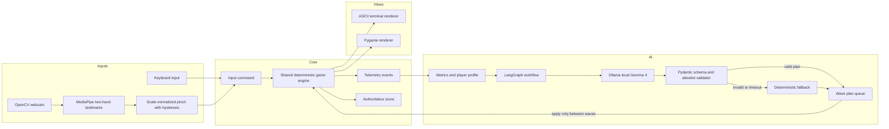
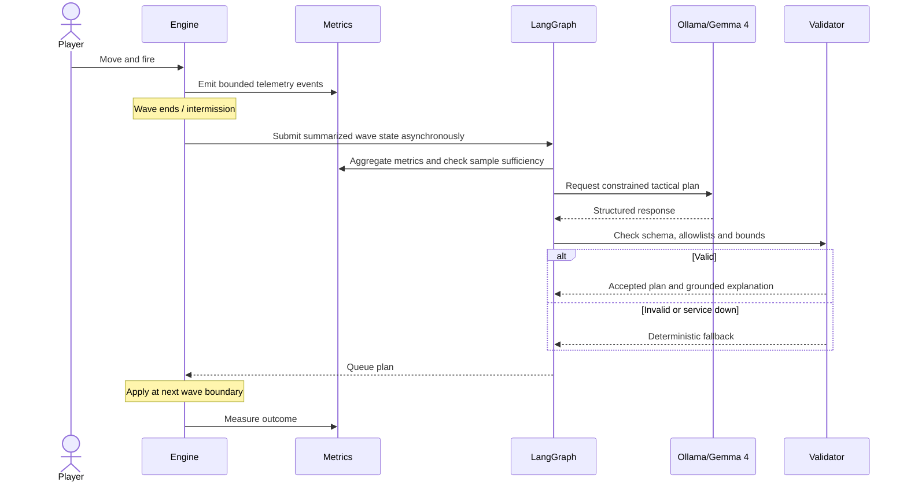

# STARFALL Architecture

## Runtime architecture

## Decision lifecycle

## Responsibilities

- `game/`: deterministic update, entities, collisions, waves and scoring.
- `controls/`: keyboard and gesture controllers emitting the same input shape.
- `vision/`: camera lifetime, MediaPipe landmarks, pinch detection and coordinate mapping.
- `renderers/`: terminal and Pygame visualization only; no game rules.
- `analytics/`: event collection, metrics, player profile and outcome comparisons.
- `ai/`: Ollama client, model configuration, prompt/schema, LangGraph, validation and fallback.
- `persistence/`: SQLite schema and repositories; no SQL scattered through game classes.
- `ui/`: terminal navigation and results.
- `scripts/`: diagnostic and local setup helpers.

## Model contract

Gemma receives a compact summary of observed telemetry and supported options. It cannot submit arbitrary code or directly mutate the engine. Pydantic validates the schema; application validation enforces allowlists and numeric limits. The game thread consumes a validated wave plan between waves. A timeout, exception or invalid result uses a deterministic fallback.

## Local setup and licensing

Ollama runs the local model API at the configured host. Local Ollama does not need a cloud API key by default. Verify the selected model tag using `ollama list` and the local inference diagnostic rather than assuming the tag is installed. Gemma is open-weight under Google's Gemma terms, not OSI-approved open-source software.